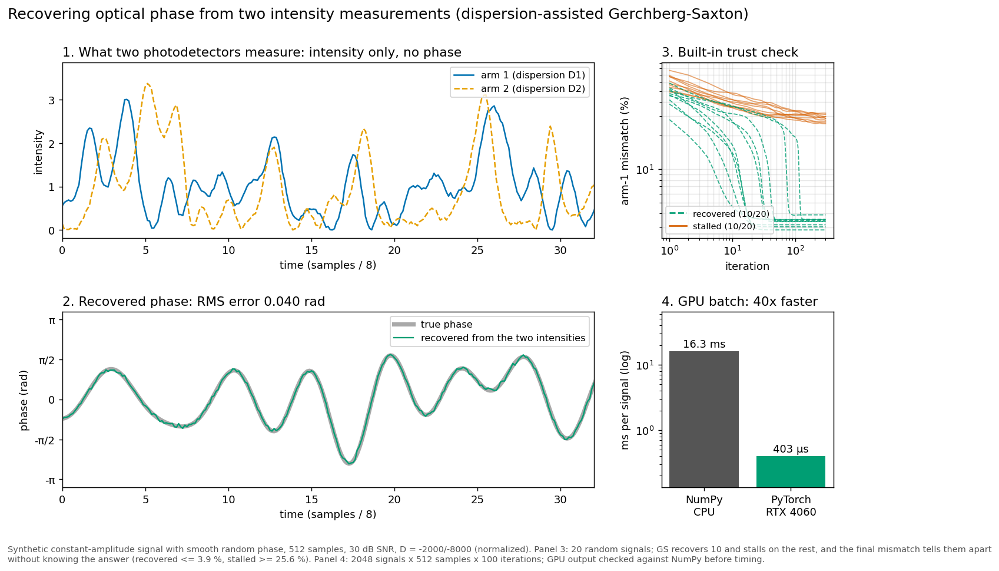
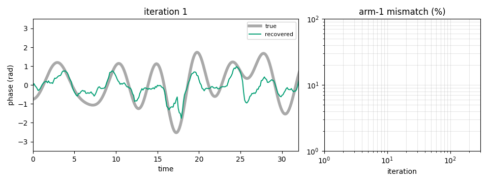

# Dispersion-assisted phase recovery

A photodetector only measures intensity, so the phase of an optical signal is lost.
If you measure the same signal twice, after two different amounts of dispersion, the
two intensity traces together pin down the phase. This repo recovers it with the
time-domain Gerchberg-Saxton algorithm (alternate between the two traces until the
field agrees with both), following Solli, Gupta and Jalali, *Appl. Phys. Lett.* 95,
231108 (2009).

It started as a UCLA ECE 279AS project (Prof. Bahram Jalali, 2024) with Gabriel
Morozowsky. It also includes a Python port of the Jalali Lab's SEALS light-scattering
MATLAB code.





The recovered phase (green) is built only from the two intensity traces in panel 1, then
compared with the true phase. Panel 3 is the useful part for real data: when GS stalls,
the mismatch stays high, so you can tell a bad answer from a good one without knowing the
truth. Panel 4 runs 2048 problems at once on an RTX 4060 with PyTorch, about 40x faster
per signal than the NumPy loop, after checking the GPU output matches NumPy to 1e-9.
Regenerate both images with `python scripts/make_hero.py`.

## Run it

```
pip install -r requirements.txt
python -m pytest tests -q
```

Then open `notebooks/results.ipynb` for the figures. To rebuild it, edit
`scripts/build_results_nb.py` and run it, then execute the notebook.

## What's here

| Path | What it is |
|---|---|
| `dgs/gs_core.py` | Dispersion operator and the GS iteration |
| `dgs/real_data.py` | Loads the two-trace files in `sample_data/` and runs GS on them |
| `dgs/temporal_gs.py`, `dgs/dispersive_fourier.py`, `dgs/gs_recursive.py`, `dgs/precision_phase_retrieval.py` | Variations and supporting math |
| `dgs/phase_retrieval_ambiguities.py` | Cases where the phase can't be recovered uniquely |
| `dgs/qiskit_gs.py`, `dgs/quantum_bridge.py` | The same problem as a quantum circuit (dispersion is a diagonal phase between two Fourier transforms) |
| `griffiths/electrodynamics.py` | Dispersion, Lorentz oscillator, Kramers-Kronig |
| `seals/scattering.py` | SEALS geometry, Mie and Rayleigh-Debye scattering, ported from `seals/matlab/` |
| `tests/` | 92 tests |

## Results

**How often GS works.** On 20 random smooth-phase test signals (D = -2000/-8000, normalized),
GS recovered 10 to under 0.15 rad RMS phase error and stalled on the other 10. Every success
ended with arm-1 mismatch at or below 3.9 %, every stall at or above 25.6 %. With gs_core's
default dispersion pair (-5000/-5750) it stalls much more often.

**GS on the sample files.** On all six signals the recovered field explains both traces.
Mismatch on the trace not enforced last drops from 40-65 % at the first iteration to
1-4 % after 2000 (QPSK is the slowest at 4.3 %).

**SEALS port.** Same default case through Python and the lab MATLAB (R2025b): scattering
angle agrees to 5e-10, Mie intensity, phase and cross section to about 1e-14.
`tests/test_seals_vs_matlab.py` checks this against a saved MATLAB run.

**Rayleigh-Debye correction.** The MATLAB returns |P(u)(1 + cos²θ)|. The intensity
should be (1 + cos²θ)·P(u)², the form factor squared. Compared with exact Mie theory for
weakly scattering spheres (where the approximation is supposed to hold), the squared
version matches and the original is off by up to a factor of ~100 in shape. The port
uses the corrected formula and keeps the original as `rayleigh_debye_matlab()` for
comparison.

## Things to know

- **The sample data is synthetic.** Each `.mat` file says so in its description field.
  Good results on it show the code is self-consistent, not that it works on lab
  measurements. Real measured traces would be the next step.
- The files label D as ps², but they were generated in `gs_core`'s normalized units.
  Their time vector is all zeros; `real_data.load()` rebuilds it from the sample rate.
- `gs_core.retrieve_phase` reports error against the trace it enforced last, which is
  ~0 after one iteration regardless of whether the answer is right. Use
  `real_data.retrieve()`, which checks the other trace. There is a test for this.
- `gs_core.make_measurements("QPSK")` is not discrete QPSK. It's a smooth, band-limited
  random phase (the test signal from the 2009 paper); only the name says QPSK.
- `seals.scattering.mie()` keeps a quirk of the MATLAB: `I_p + I_s` is twice the
  unpolarized intensity. Halve it before comparing with Rayleigh or RDG.

## History

This branch is a trimmed copy of a much larger working repo. The full history, including
course notebooks unrelated to phase recovery, is on the `archive/full-history-2026-10-12`
and `session/physics-notebooks-2026-10-26` branches.
