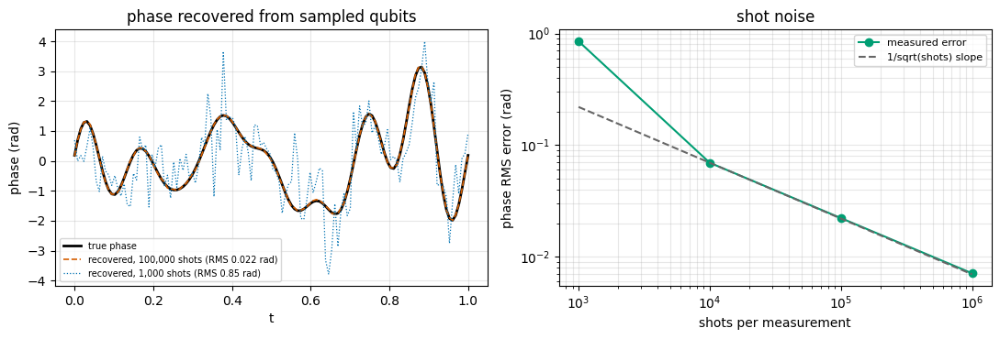

# Dispersion-Assisted Phase Recovery

**Recovering the phase of an optical signal from intensity-only measurements**, in Python, with a Qiskit quantum-circuit version and machine-checked proofs in Lean 4.

A photodetector records only intensity, |E|², so the phase of the light is lost. That phase carries the data in coherent optical links and the shape of the pulse in ultrafast measurements. This project recovers it without a reference laser. The signal is recorded after two known, different amounts of fiber dispersion, and the Gerchberg-Saxton algorithm iterates between the two recordings until it finds the one phase consistent with both.



*Left: the true phase (black) and the phase recovered from 100,000 sampled measurements (dashed orange, on top of it) and from 1,000 (dotted blue, too few). Right: the error falls as 1/√shots, the shot-noise limit.*

## Results (simulated data)

| result | number |
|---|---|
| phase recovered from two dispersed intensity measurements (smooth band-limited phase, 25 dB SNR) | **0.061 rad** RMS error |
| one dispersion instead of two | fails (1.69 rad, close to random), which is why two are needed |
| recovery from sampled photon counts | 0.070 / 0.022 / 0.007 rad at 10⁴ / 10⁵ / 10⁶ counts: **error ∝ 1/√counts** |
| same algorithm with the dispersion built as a 7-qubit Qiskit circuit | matches the FFT model to **~10⁻¹³**; no quantum speedup (stated, not claimed) |
| Gerchberg-Saxton error over 60 iterations | **never increases**, as proved in Lean (error-reduction property) |
| a text message sent as QPSK optical phase, detected with intensity only (5 dispersions, CRC-4, pilots) | received **error-free from 15 dB SNR** up; at 10 dB, 1 of 26 characters wrong and flagged by the CRC |
| an electron wavefunction recovered from position densities at several times (free Schrödinger evolution = dispersion) | fidelity **1.000000** from 3+ times (0.74 from 2), in Python, C and CUDA |
| three receivers on a 32 GBd, 20 km fiber link (split-step NLSE, amplifier + photodiode noise) | coherent: error-free at 20 dB OSNR; Kramers-Kronig and dispersion-assisted GS: FEC limit near 32 dB, GS with no receiver laser or carrier but ~300× the computation |
| data symbols (QPSK) need more measurement diversity than smooth phases | frames recovered: 8/40 with 2 dispersions, 27/40 with 3, 37/40 with 4, **40/40 with 5** |

## Skills shown

- **Optical communications:** coherent detection, Kramers-Kronig receivers, split-step simulation of the nonlinear Schrödinger equation, BER vs OSNR.
- **Circuits:** photodiode transimpedance-amplifier design in SPICE (bandwidth, peaking, noise), solved symbolically in SymPy.
- **Communications:** framing, Gray-coded QPSK, pilot symbols, CRC-4 error detection, retries, character error rate versus SNR.
- **Signal processing and optics:** dispersion as a quadratic spectral phase, FFT-based forward models, alternating projections, Wirtinger flow, Poisson noise, coherent (IQ) detection.
- **C and CUDA:** a C11 program with its own FFT (gcc), a cuFFT version (nvcc), errors reported as exit codes; a shebang command-line driver.
- **Quantum mechanics:** free Schrödinger evolution, wave-packet spreading, wavefunction phase retrieval.
- **Python:** NumPy, SciPy, Matplotlib, pandas, PyTorch, Jupyter.
- **Quantum computing (Qiskit 2.x):** QFT and diagonal phase gates, state preparation, shot sampling with `StatevectorSampler`, transpiled gate counts (about 350 CNOTs).
- **Symbolic math (SymPy):** derivations of the field model, the dispersion kernel and the GS projections.
- **Formal verification (Lean 4 + Mathlib):** proofs that intensity is blind to phase, that dispersion is all-pass, that the GS magnitude step is the closest possible correction, and that the GS error can never increase.
- **Software practice:** pytest suite (22 tests), results tied to fixed random seeds, a materials library checked against published refractive-index data.

## What's in the repository

| file | what it does |
|---|---|
| `dgs/gs_core.py` | forward model (two dispersed intensity measurements, with noise) and Gerchberg-Saxton phase retrieval, NumPy only |
| `dgs/qiskit_gs.py` | the same retrieval with the dispersion as a Qiskit circuit (inverse QFT → diagonal phase → QFT) and intensities sampled from qubits |
| `dgs/materials.py` | refractive index and dispersion of fused silica, N-BK7, sapphire, CaF₂ and LiNbO₃ (Sellmeier equation) |
| `lean/PhaseRetrieval.lean` | the Lean 4 + Mathlib proofs (8 theorems) |
| `notebooks/phase_retrieval.ipynb` | the full course notebook: forward model, time-domain GS, PhyCV baseline, Wirtinger flow, noise, coherent detection, 2D phase retrieval, MATLAB figures reproduced, Lean section |
| `notebooks/qiskit_gs_phase_recovery.ipynb` | the Qiskit version end to end, with shot-noise and gate-count analysis |
| `notebooks/quantum_phase_retrieval.ipynb` | the same algorithm for a quantum wavefunction (Pauli's question): SymPy, Python, C (gcc, WSL), CUDA (nvcc, cuFFT), Lean |
| `tools/qgs/` | `gs_wavefunction.c` (C11, own FFT), `gs_wavefunction.cu` (cuFFT), `run_qgs.py` (shebang driver; errors as exit codes) |
| `lean/QuantumPhaseRetrieval.lean` | Lean proofs: unitary free evolution, time-evolution group, conjugation = time reversal, global phase |
| `notebooks/receiver_comparison.ipynb` | coherent vs Kramers-Kronig vs dispersion-assisted GS receivers: BER vs OSNR, Kerr effect, hardware and compute cost, with references |
| `dgs/receivers.py`, `tests/test_receivers.py` | split-step fiber model and the three receivers, with tests |
| `spice/tia_frontend.cir` | PSpice/ngspice netlist of the photodiode + transimpedance amplifier front end (28 GHz, 500 Ω, ~20 pA/√Hz) |
| `lean/Receivers.lean` | Lean proofs: balanced and quadrature detection, the Kramers-Kronig no-zero condition, power splitting |
| `notebooks/text_over_phase.ipynb` | a full link: text → bits → QPSK phase → dispersion → intensity-only detectors → phase recovery → text |
| `notebooks/demo_dispersion_gs.ipynb` | a short end-to-end demo |
| `tests/test_qiskit_gs.py`, `tests/test_materials.py` | checks the circuit against the FFT model, the recovery, and the material data |
| `docs/phase_recovery.png` | the figure above |

## Quick start

```bash
pip install -r requirements.txt
python -m pytest tests -q
jupyter lab notebooks/demo_dispersion_gs.ipynb
```

The Lean proofs need a Lean 4 + Mathlib setup; the notebooks skip that check when one isn't installed.

## Limits

Every result is from simulation; the next step is measured data from a dispersive-fiber setup. Only second-order dispersion is modeled, and the main examples assume a constant-amplitude signal. The two-dispersion results use a smooth, band-limited test phase; true QPSK data needs more measurements (see `notebooks/text_over_phase.ipynb`). Intensity measurements can never recover a constant phase offset or a sign flip of the phase, so results are reported after removing both.

## License

MIT License, copyright (c) 2026 Colin Casey. See [`LICENSE`](LICENSE).

## About

Started as a UCLA ECE 279AS course project (2024) and continued at Sacramento State in computer engineering. By Colin Casey. Built with the help of an AI coding assistant; every number above is reproduced by the tests and notebooks, and the core math is checked in Lean.

The earlier, much larger version of this repository (more notebooks, C and CUDA ports, coursework, full commit history) is on the branch [`archive/full-history-2026-10-12`](../../tree/archive/full-history-2026-10-12).
