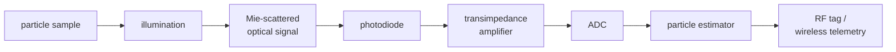

# Scarlett Particle Tagging

A **simulation-first** research project: use Mie scattering to characterize
particles in a controlled laboratory sample, and model the electronics that
would read the signal out.

From optical measurements the system estimates particle **diameter**,
**refractive index**, **concentration** and **motion**. An RF layer then
labels the result with a tag ID and a timestamp and sends it off the bench.

> **Status.** Everything here is a model. There is no hardware, no
> fabricated chip and no experimental data. Every number in `results/` and in
> the notebook is synthetic. See
> [What this project does not claim](#what-this-project-does-not-claim).

**Scope.** Bench-top characterization of particle samples in a cuvette or
flow cell. This project does not design covert tracking, weapon systems or
surveillance of people, and the RF tag identifies a sample container, not a
person.

## If the particle diameter makes you anxious

> Diameter is simply a model parameter. We do not need to know it perfectly
> at first. We can test a range of possible diameters and study how the
> predicted signal changes.

That is the whole method. `dia` is a number you hand to a function. Hand it
5 µm and you get one predicted pattern; hand it 5.1 µm and you get a slightly
different one. Section 5 of the notebook sweeps `dia ± uncertainty` and plots
the result. The estimator does the same thing in reverse: it tries a few
hundred diameters, keeps the ones the data cannot rule out, and reports that
range as a confidence interval. You never have to guess right the first time.

## Signal chain



RF tagging is a separate identification and telemetry layer. It does not
replace the optical scattering physics; all particle information comes from
the light. Component definitions (photodiode responsivity, transimpedance
gain, ADC resolution, sampling frequency, noise floor, tag ID, timestamp,
particle estimate, confidence interval) and the conceptual ASIC architecture
are in [docs/ARCHITECTURE.md](docs/ARCHITECTURE.md).

## Quick start

Python 3.10 or newer.

```bash
python -m venv .venv
source .venv/bin/activate          # Windows: .venv\Scripts\activate
pip install -r requirements.txt
pip install -e .
```

```bash
python -m pytest                              # unit tests
python scripts/generate_synthetic_data.py     # synthetic dataset      -> results/
python scripts/make_plots.py                  # main plots             -> results/
python scripts/calibrate_and_uncertainty.py   # calibration + uncertainty -> results/
```

With `make` available, `make all` runs the lot; `make help` lists the targets.

MATLAB (R2020a or newer for `exportgraphics`):

```bash
matlab -batch "addpath('matlab'); scarlett_setup; test_rayleigh_mie_limits"
matlab -batch "addpath('matlab'); scarlett_setup; run_scarlett_plots"
```

C estimator (any C99 compiler):

```bash
gcc -std=c99 -O2 -Wall -Wextra -o c/scarlett_estimator c/main.c c/scarlett_estimator.c -lm
python scripts/export_c_test_vectors.py
./c/scarlett_estimator estimate results/c_vectors/estimate.txt
```

All paths are relative to the repository. Outputs go to `results/`.

## Repository layout

| Layer | Python | MATLAB | Notes |
|---|---|---|---|
| Physics model | `src/scarlett/physics.py` | `matlab/physics/` | Rayleigh, Rayleigh-Debye, Mie, SEALS map, Brownian motion |
| Sensor model | `src/scarlett/sensor.py` | `matlab/sensor/` | illumination, photodiode, TIA, PGA, ADC, noise |
| Estimator | `src/scarlett/estimator.py` | – | diameter, index, concentration, motion, intervals |
| ASIC behavioural model | `src/scarlett/asic.py`, `c/` | – | fixed-point correlator bank, autocorrelator |
| RF telemetry model | `src/scarlett/telemetry.py` | – | packet, CRC, link budget |
| Synthetic data | `src/scarlett/synthetic.py` | – | seeded generator |
| Visualization | `src/scarlett/visualization.py` | `matlab/visualization/` | all plots, units on every axis |
| Tests | `tests/` | `matlab/tests/` | limits, identities, parity |

```text
scarlett-particle-tagging/
├── README.md, LICENSE, pyproject.toml, requirements.txt, Makefile
├── docs/
│   ├── CODE_REVIEW.md       bugs and inconsistencies found in the original MATLAB
│   ├── ELECTRODYNAMICS.md   E, B, refractive index, amplitude, polarization, Poynting vector
│   ├── ARCHITECTURE.md      block diagram, sensor definitions, ASIC proposal, RF layer
│   └── VARIABLES.md         every variable: meaning, unit, datatype, source equation
├── src/scarlett/            physics, sensor, estimator, asic, telemetry, synthetic, visualization
├── matlab/                  physics/, sensor/, visualization/, tests/, scarlett_setup.m
├── c/                       scarlett_estimator.c/.h, main.c
├── scripts/                 generate_synthetic_data, make_plots, calibrate_and_uncertainty,
│                            export_c_test_vectors, build_notebook
├── notebooks/scarlett_main_plots.ipynb
├── tests/                   pytest suite
└── results/                 generated outputs (empty in a fresh clone)
```

## Physics model in one page

Inputs: particle diameter `dia` (radius `= dia/2`), wavelength `lambda`,
particle index `npar`, medium index `nmed`, scattering angle `theta`,
measurement distance `r`. SI units, radians.

Size parameter:

```text
x = pi*dia/(lambda/nmed)
```

| Regime | Valid when | Model |
|---|---|---|
| Rayleigh | `x << 1` | point dipole, `sigma ∝ dia^6 / lambda^4` |
| Rayleigh-Debye | `m` close to 1 and `2x(m-1) << 1` | dipoles interfering over the volume |
| Mie | any `x` (homogeneous sphere) | exact multipole sum |

The plots cover scattered irradiance, the two polarization components, phase,
cross section, wavelength dependence and the sensitivity to `dia ±
uncertainty`. Log scales are used where the range demands it, and every axis
states its unit.

The physics is classical electrodynamics. The relation between electric
field, magnetic field, refractive index, wavelength, scattering amplitude,
polarization and the Poynting vector is written out in
[docs/ELECTRODYNAMICS.md](docs/ELECTRODYNAMICS.md). Quantum light enters only
as photon energy `E = h*f`, shot noise, Poisson counting statistics and the
coherent/incoherent distinction. The classical Mie field is not a quantum
wavefunction; that page explains the difference.

## Relation to the original MATLAB code

The project starts from a MATLAB simulation of SEALS (Spectrally Encoded
Angular Light Scattering; Adam et al., *Optics Express* 21, 28960, 2013):
`main.m`, `mie.m`, `rayleighdebye.m`, `SEALS.m`.

- The equations are preserved. The cleaned MATLAB functions reproduce the
  originals to about 1e-15 (`matlab/tests/check_against_original.m`), and the
  Python port matches the cleaned MATLAB output to 1e-8 or better.
- The review found ten bugs, six unit inconsistencies and a set of unclear
  names. They are listed with their effects in
  [docs/CODE_REVIEW.md](docs/CODE_REVIEW.md). The two that change results:
  the original plotted `I_p + I_s`, which is twice the unpolarized
  irradiance, and the Rayleigh-Debye function used the form amplitude to the
  first power instead of squared.
- Each fix can be switched off (`'legacy'` in MATLAB, `legacy=True` in
  Python) to reproduce the original numbers.
- The original files are **not redistributed** here. They were written in the
  UCLA Jalali Lab; ask the lab before publishing anything derived from them.

## Results on synthetic data

From `scripts/calibrate_and_uncertainty.py` with seed 0. The simulated sample
is a dilute suspension of 5.000 µm beads (index 1.57) in water, 20 particles
in a 1 nL probe volume. **These numbers describe the simulation, not an
instrument.**

| Quantity | Synthetic truth | Estimate |
|---|---|---|
| Diameter (angular pattern) | 5.0000 µm | 4.9980 µm, 95 % interval 4.9927–5.0031 |
| Concentration | 2.000e13 /m³ | 1.995e13 /m³, 95 % interval 1.981e13–2.009e13 |
| System gain (calibration) | 1.07 (hidden) | 1.066 ± 0.004 |
| Diameter (motion, Stokes-Einstein) | 5.00 µm | 5.04 µm, 95 % interval 4.57–5.61 |

Over 60 Monte Carlo trials the diameter scatter was 3.0 nm against a
Cramér-Rao bound of 2.7 nm, and the 95 % interval contained the truth in 92 %
of trials. Leaving out the gain calibration shifts the concentration by
+6.3 % and leaves the diameter unchanged.

The nanometre-level precision is what the noise model allows **if** the
particle is a perfect homogeneous sphere with a known refractive index and
exactly known angles. It is not a prediction of real accuracy.

## Variables

Every variable with its meaning, unit, datatype and source equation is in
[docs/VARIABLES.md](docs/VARIABLES.md). The core ones:

| Variable | Meaning | Unit | Datatype | Source equation |
|---|---|---|---|---|
| `dia` | particle diameter | m | float | input (model parameter) |
| `radius` | particle radius | m | float | `dia/2` |
| `lambda` (`lam` in Python) | vacuum wavelength | m | float | input |
| `npar`, `nmed` | particle and medium refractive index | – | float | input |
| `theta` | scattering angle | rad | float array | input |
| `r` | measurement distance | m | float | input |
| `x` | size parameter | – | float | `pi*dia/(lambda/nmed)` |
| `S1`, `S2` | scattering amplitudes | – | complex array | Mie multipole sums |
| `I_par`, `I_perp` | polarization components of the irradiance | W/m² | float array | `I0·abs(S2)^2/(k r)^2`, `I0·abs(S1)^2/(k r)^2` |
| `sigma_sca` | scattering cross section | m² | float | `Q_sca·pi·dia^2/4` |

## What this project does not claim

- **No experimental results.** No measurement was taken. All data are
  generated by `scarlett.synthetic` from a fixed seed, and every output file
  is marked synthetic.
- **No fabricated ASIC.** The ASIC is an architecture proposal with a
  behavioural simulation of its digital arithmetic. There is no circuit
  design, layout, process node, power or area figure, or silicon.
- **No validated instrument accuracy.** The confidence intervals cover random
  noise under an idealized model. Non-spherical or inhomogeneous particles,
  size distributions, uncertain refractive index, multiple scattering,
  misalignment and stray light are not modelled.
- **No reproduction of the paper's measurements.** The analytic
  wavelength-to-angle map is reproduced; the measured bead scattering curves
  are not. The default map is also offset by roughly 8–10° from the paper's
  Fig. 3 (see the code review).
- **No radio on a particle.** A micrometre-scale particle cannot work as an
  antenna at radio wavelengths. The tag identifies a sample container.
- **No tracking or surveillance capability**, and no location information of
  any kind.
- **No realistic radio link.** The link budget is free space; walls,
  multipath and interference are ignored. Real transmission needs a certified
  module and regulatory compliance.
- **No optical design.** The sensor model assumes a point detector, a known
  probe volume, no refraction at the sample window and no absorption in the
  medium. Water does absorb near 1.6 µm; over a short path this is small but
  it is not included.
- **No claim that the classical field is a quantum wavefunction.** Quantum
  effects are limited to photon energy and counting statistics.
- **No safety assessment.** A real bench with a laser needs institutional
  laser-safety training and procedures before any work starts.

## Licence and credits

New code in this repository is released under the MIT licence (`LICENSE`).
The physics follows Bohren and Huffman, *Absorption and Scattering of Light
by Small Particles*, in the formulation of C. Mätzler's MATLAB routines, and
the SEALS mapping follows Adam, Mahjoubfar, Diebold, Buckley and Jalali
(2013). The cleaned MATLAB functions are derived from lab code that is not
included; check with its owners before public release.
