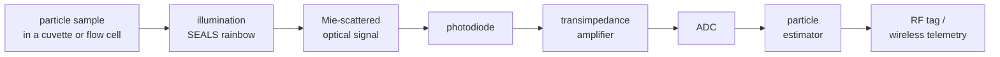

# System architecture

Everything on this page is a **design proposal with a behavioural
simulation**. No hardware has been built, no ASIC has been designed at
transistor level, and all component values are nominal assumptions.

## 1. Signal chain

`results/block_diagram.png` (written by `scripts/make_plots.py`) shows the
same chain with the proposed ASIC partition.

RF tagging is a separate **identification and telemetry layer**. It carries
the estimate; it does not sense anything. All particle information comes
from the optical scattering.

## 2. Sensor chain definitions

Defaults live in `scarlett.sensor.SensorConfig` and `OpticalBench`. They are
round, plausible numbers for simulation, not a parts list.

| Quantity | Symbol / field | Default | Unit | Definition |
|---|---|---|---|---|
| Photodiode responsivity | `responsivity` | 1.0 | A/W | photocurrent per watt of light: `i = R·P` |
| Dark current | `dark_current` | 1e-9 | A | current with no light |
| Transimpedance gain | `tia_gain` | 1e6 | V/A | `v = i·R_f` |
| Programmable gain | `pga_gains` | 1…128 | – | powers of two, chosen so the peak sits below 80 % of full scale |
| Anti-alias cutoff | `antialias_cutoff` | 40e3 | Hz | single-pole low-pass, must be below `f_s/2` |
| ADC resolution | `adc_bits` | 12 | bit | `LSB = V_ref / 2^bits` = 244 µV |
| ADC full scale | `adc_vref` | 1.0 | V | unipolar |
| Sampling frequency | `sampling_rate` | 100e3 | Hz | `f_s` |
| Samples per channel | `samples_per_channel` | 16 | – | averaged per angle channel |
| Noise floor | `noise_floor_power()` | 4.1e-11 | W | optical power giving SNR = 1 in one sample (see below) |

Noise budget, referred to the photodiode current, bandwidth `B = (π/2)·f_c`:

| Term | Formula | Value at defaults |
|---|---|---|
| Shot | `sqrt(2 q (i + i_dark) B)` | 4.5e-12 A at zero signal |
| Thermal (feedback resistor) | `sqrt(4 k_B T B / R_f)` | 3.2e-11 A |
| Amplifier | `i_n · sqrt(B)` | 2.5e-11 A |
| ADC quantization | `LSB / sqrt(12)` after gain | 70 µV / gain |

Telemetry record (`scarlett.telemetry.TagReport`, 42 bytes on the wire):

| Field | Meaning | Encoding |
|---|---|---|
| tag ID | identifies the **sample container**, not a person or a particle | 32-bit unsigned |
| timestamp | milliseconds since the instrument epoch | 64-bit unsigned |
| particle estimate | diameter, refractive index, concentration, diffusion | diameter in nm (32-bit), index × 1000 (16-bit), two 32-bit floats |
| confidence interval | lower and upper diameter bound, and its level | nm (32-bit each), percent (8-bit) |
| flags | ambiguous fit, ADC clipped, poor fit, no motion data | 8 bits |
| CRC-16 | detects corrupted packets | CCITT, polynomial 0x1021 |

## 3. Dynamic range and the equalization filter

Forward scattering is far brighter than side scattering. For the reference
bead in the simulation the usable channels span more than 100:1 in power,
and the brightest would saturate the ADC while the dimmest sat below one
count. The SEALS paper solves this optically: because each wavelength goes to
one angle, a spectral filter can give more power to the wavelengths that map
to dim angles. `sensor.design_equalization` models that filter (limited to
30 dB). The filter is part of the known instrument, so it is included in the
estimator's templates.

## 4. Conceptual ASIC architecture (proposal)

**Status: architecture proposal and behavioural simulation. No ASIC has been
designed at circuit level, fabricated or measured.** `scarlett.asic` and
`c/scarlett_estimator.c` model only the arithmetic of the digital blocks.

| Block | Domain | Function | Behavioural model |
|---|---|---|---|
| Photodiode input | analog | current input, protection | `sensor.acquire` |
| Transimpedance amplifier | analog | current to voltage | `sensor.acquire` |
| Programmable gain | analog | ×1 … ×128, auto-ranged | `sensor.choose_pga_gain` |
| Anti-alias filter | analog | low-pass below `f_s/2` | noise bandwidth in `SensorConfig` |
| ADC | mixed | 12 bit, 100 kS/s (nominal) | `sensor.acquire` |
| Averager + dark subtraction | digital | sum 2ⁿ samples, subtract stored dark level | `asic.subtract_dark` |
| Autocorrelation block | digital | integer lag products for motion | `asic.integer_autocorrelation` |
| Calibration memory | digital | dark codes, 16-bit Mie templates, template norms | `asic.CalibrationMemory` |
| Digital estimator | digital | correlator bank, best match, confidence set | `asic.fixed_point_estimate` |
| RF telemetry interface | digital | packet framing and CRC to a radio | `telemetry.encode_packet` |

An FFT block is the usual alternative to the autocorrelator (the two are
related by the Wiener-Khinchin theorem). Only the autocorrelator is modelled.

Proposed word lengths: 12-bit ADC samples; 20-bit dark-subtracted sums of 16
samples; 16-bit signed templates; 48-bit correlator accumulators. The model
raises an error if a value would not fit.

**How the digital estimator works.** For each stored template `T_k` it forms
`corr_k = Σ v_j T_kj` (one multiply-accumulate per channel) and the statistic
`corr_k² / |T_k|²`. The largest statistic is the least-squares best match.
Templates within a chi-square threshold of the best form the confidence set.

What the proposal does **not** contain: transistor-level circuits, a process
node, layout, power or area figures, timing closure, or test results. Those
would need real design work and cannot be inferred from a behavioural model.

Two findings from the behavioural model that would matter in a real design:

- Rounding templates to 16 bits changes each template's energy by about
  1 part in 10⁴. In the default configuration that shifts chi-square by about
  40 % of the 95 % threshold, so the estimator uses the exact stored energy
  rather than assuming unit energy.
- The fixed-point estimator assumes equal noise on all channels and has the
  resolution of the lookup table (20 nm here). The floating-point reference
  weights channels individually and refines between grid points, reaching a
  few nanometres in the simulation.

## 5. RF telemetry layer

`scarlett.telemetry` models packet framing, a free-space (Friis) link budget
at 2.44 GHz and random bit errors. The default link at 5 m has a large
margin because free space is the best case; walls, multipath and
interference are not modelled.

Scope limits, stated plainly:

- The tag names a sample container on a lab bench. There is no position, no
  person and no tracking function.
- A particle a few micrometres across cannot act as an antenna at radio
  wavelengths of centimetres. Nothing here puts a radio on a particle.
- A real transmitter must use a certified radio module and follow local
  radio regulations.
